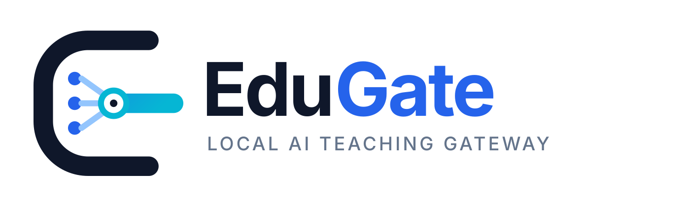

<p align="center">
  
</p>

# EduGate Standalone Classroom

<p align="center">
  <a href="README.md">中文</a> · <strong>English</strong>
</p>

EduGate runs on a teacher's 64-bit Windows computer or Apple Silicon Mac for a single teacher and a local classroom. The teacher configures model providers, knowledge sources, and the active classroom policy in a web console. Students join through a stable LAN classroom link.

It can also act as a classroom AI relay: trusted backend clients use an OpenAI-compatible API, while teaching webpages use a scoped student-session streaming API.

## v2.4.1: portable classrooms, full teacher previews, and UI alignment

The Windows release uses a portable folder, one EXE launcher, and a browser interface. Keep the complete folder when moving between computers. Directory isolation, confirmed safe exit, and data-preserving program upgrades are included.

Under Resources → Blacklist and trial, teachers can generate the final answer a student would receive, using the saved model, teaching policy, lesson scope, and global blacklist. The preview shows question checks, evidence decisions, final-answer checks, and references. Follow-up questions are supported; a new-round button clears the preview context. Previews work before class starts, have a separate request-log route, and never enter student classroom records.

Version 2.4.1 aligns card headings, form controls, refresh actions, and the backup/upgrade columns. Sticky primary and secondary tabs stay together while scrolling. Teacher previews show the model's display name, keep action widths stable, and collapse long question headings without discarding their text. See the [visual verification report](docs/ui/2026-10-26-visual-alignment.md).

Download the [Windows x64 release](https://github.com/bd4rex/EduGate-standalone/releases/tag/v2.4.1). This release does not include a new macOS binary; macOS source support remains available.

The [2.3 → 2.4 process archive](docs/history/releases-2.3-to-2.4.md) preserves the original Windows packages and a separate runtime-source history. Reconstructed historical sources are verified against release bytecode and explicitly labelled with their archival date and scope.

## Security model

- There is one teacher administrator; multi-teacher account and policy APIs are not part of the standalone edition.
- A classroom token is exchanged for an independent student session. Student clients never receive the teacher token.
- `ALLOW_LAN_ADMIN=false` by default: the teacher page, login, API docs, and every management API are limited to the host computer. A management tablet requires LAN administration plus an exact `ADMIN_ALLOWED_IPS` entry.
- The classroom token persists across classes and restarts. Ending a class revokes current student sessions and pauses the link; starting again reuses the same link. Only an explicit rotation permanently invalidates it.
- Classroom records, configuration, and knowledge files stay on the teacher computer.
- Student Python runs in a disposable, opaque-origin browser Worker using bundled offline Pyodide/WASM, never on the teacher's host. Reported results are labelled untrusted.
- Ending, restarting, or rotating a class cancels its queued/in-flight AI work; late records retain the original class. Disabling a platform key persists across restarts and does not fall back to an environment key.
- Knowledge indexes use local relative paths and rebase recognized legacy absolute paths without touching the original installation. Unsafe paths and directory links are rejected.
- Backend integrations use a separate platform key. Browser code exchanges the classroom token for a student session and must never contain the platform key.
- Teachers can upload an HTML file or a ZIP containing `index.html` and publish it as the student entry. The bundled IP worksheet is now explicitly a Demo page; neither Demo nor published pages can use classroom services before class starts.

## Downstream integrations

The System page exposes copyable integration details:

- Server-side clients: `GET /v1/models` and `POST /v1/chat/completions`, with Base URL `http://teacher-ip:port/v1`, virtual model `edugate`, and `Authorization: Bearer <platform key>`.
- Teaching webpages: load `assets/edugate-client.js`, exchange the persistent classroom token through `/classroom/join`, then consume `/chat/stream` using the resulting student token.
- Hosted teaching pages: upload HTML/ZIP in System → Teaching page publishing. This is the default embed mode: copy the provided code and distribution URL, with no separate SDK installation or CORS setup. EduGate switches the student link and QR code to the active page and injects a sandboxed `EduGate.ask()` streaming bridge without exposing credentials to the uploaded page.

The stable `edugate` model follows the teacher's current upstream model, prompt, and knowledge-base policy. Cross-origin teaching pages require an exact `CORS_ORIGINS` entry and a service restart. The platform key is server-side only; the classroom token embedded in a page grants student access and is revoked by rotating the classroom link.

The System page uses secondary tabs for runtime status, model services, webpage publishing, integration, advanced settings, logs, and backup/upgrade. Resources uses Library, Lesson scope, and Blacklist and trial. All dropdowns share a keyboard-accessible menu style.

Upstream connections can be saved before discovering or importing models. Provider settings live in `data/runtime_config.json` and credentials in `data/secrets.json`; discovery also saves the connection first. The standalone platform key is initialized once (25 characters with 128 bits of randomness), remains stable across restarts, and can be revealed or copied by the teacher. Existing keys and disabled states are preserved. Only an explicit replacement or generation changes the key. The developer call example is optional and collapsed by default.

Use `EduGateClient.runPython(code, {onOutput, signal})` in external pages, or `EduGate.runPython(code, onOutput)` in hosted pages. The old `/run_python` and `/run_python/stream` routes return **410 Gone** after classroom authentication. The bundled runtime includes the standard library, without pip or interactive input. CPU and memory usage is local to student devices; classroom controls restrict service access and result reporting, not students' independent local computation.

LAN entry addresses are selected from connected non-virtual IPv4 interfaces. Override `LAN_ADVERTISE_IP` in Advanced Settings when needed, then restart. This only changes advertised URLs, not teacher permissions. Unsaved advanced settings are preserved during status polling and manual refresh.

## Run the packaged edition

On Windows, keep the complete `EduGate-Standalone` folder together and launch `EduGate-Standalone.exe`. On an Apple Silicon Mac running macOS 11 or later, extract the ZIP and open `EduGate.app`; because this build is ad-hoc signed and not notarized with an Apple Developer ID, Control-click the app and choose Open on first launch. The current macOS package does not support Intel Macs.

Add a model provider, configure the default classroom, and optionally publish a teaching webpage from the System page. Start class before distributing the stable student link or built-in QR code. The same token can be reused until the teacher explicitly rotates it; ending class makes both the hosted page and Demo unavailable.

Windows stores portable data beside the executable. macOS stores configuration, model credentials, knowledge files, records, and logs in `~/Library/Application Support/EduGate`, so replacing `EduGate.app` does not remove classroom data.

To support local backup and migration, macOS stores model credentials in a portable format and restricts the data directory to the current user. Do not share the complete EduGate data directory or upload it to a public drive or repository.

An IP allowlist is network admission control, not a replacement for authentication. A LAN management device must still sign in and use an `X-Admin-Token`; reserve its DHCP address and use this feature only on a trusted, isolated network without exposing plain HTTP beyond it.

The packaged edition includes its own runtime. The source edition requires 64-bit Python 3.10 or newer. Windows can use:

```text
desktop\install_backend_deps.bat
desktop\run_standalone.bat
```

macOS can use:

```bash
python3 -m venv runtime/venv
runtime/venv/bin/python -m pip install -r backend/requirements.txt
runtime/venv/bin/python desktop/edugate_standalone.py
```

## Development

Knowledge retrieval now combines Chinese keyword search and local semantic embeddings with LanceDB and FastEmbed. Teachers can scope documents by file, chapter and textbook edition, inspect parsed content, and let students verify sources. A persistent classroom blacklist applies to regular chat, SSE and the OpenAI-compatible endpoint. It checks related topics and complete output before display, and declines to answer when policy checks are unavailable. This adds model calls and latency; it is not a guarantee of perfect semantic classification. See the [knowledge/blacklist guide](docs/知识库与课堂黑名单.md) and [implementation evidence](docs/research/2026-10-24-knowledge-implementation.md).

Packaged builds include the local Chinese embedding model. Source installations can prepare it with `python desktop/prepare_knowledge_model.py`; answer generation and topic/evidence checks still use the configured model provider. Scanned pages and visual formulas require separate OCR/review.

```powershell
python -m pytest -q --basetemp=.pytest-tmp
python -m compileall -q backend\app
```

The backend is split into application composition (`main.py`), shared state, dependencies, chat services, a published-page store, schemas, runtime configuration, and domain routers. See the [Chinese documentation index](docs/README.md) and the [teaching page publishing guide](docs/教学网页发布.md) for the maintained operations, security, and development guides.

Build the Windows folder with `desktop\build_windows.bat`. On Apple Silicon, use Python 3.10–3.12 and run `EDUGATE_VERSION=2.4.1 desktop/build_macos.sh` to retain the macOS 11 target and produce the signed `.app` and release ZIP. The build scripts prepare and bundle the pinned embedding model.


## Portable folders and data-preserving upgrades

On Windows, carry the complete folder and launch its single `EduGate-Standalone.exe`. Each folder locks its own data; duplicate launches only reopen that same instance. Other teachers use separate ports. The launcher does not import legacy machine data automatically, and the browser does not restore another teacher's selected knowledge base.

Use **End class and exit** (Chinese UI: 结束课堂并退出), then wait for the Windows confirmation before safely ejecting the drive. A disconnected browser is not proof that data was saved. The local OS helper checks that the application process exited and that database flushing completed.

Under System / Program upgrade, upload the new program release ZIP. It validates the manifest, ends the class, saves, replaces only program files, and restarts. `config` and `data` remain in place; previous program files are kept under `data/updates`. Replacement failures attempt rollback. Do not unplug during an upgrade. The package includes the runtime and retrieval model; AI answers still require access to the configured upstream service.

New builds go to a fresh `dist/releases/<version>-<timestamp>/` directory instead of overwriting an existing portable folder. Real-process acceptance is available through `desktop/verify_portable.py --package <clean-package-folder> --upgrade <release.zip>`. This simulates relocation on the development computer; a second physical classroom PC and its LAN policy still need on-site acceptance.
