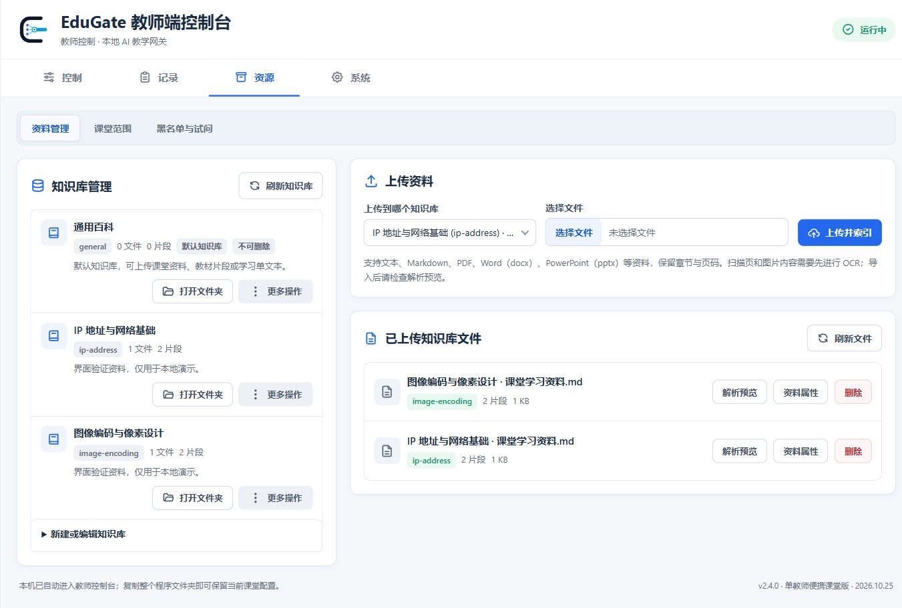
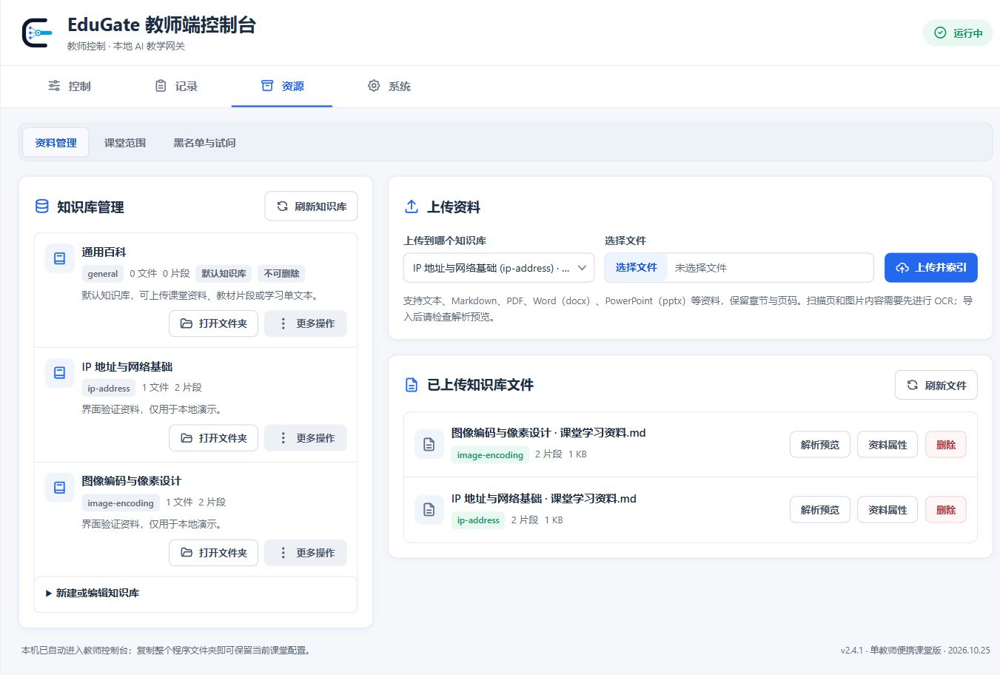
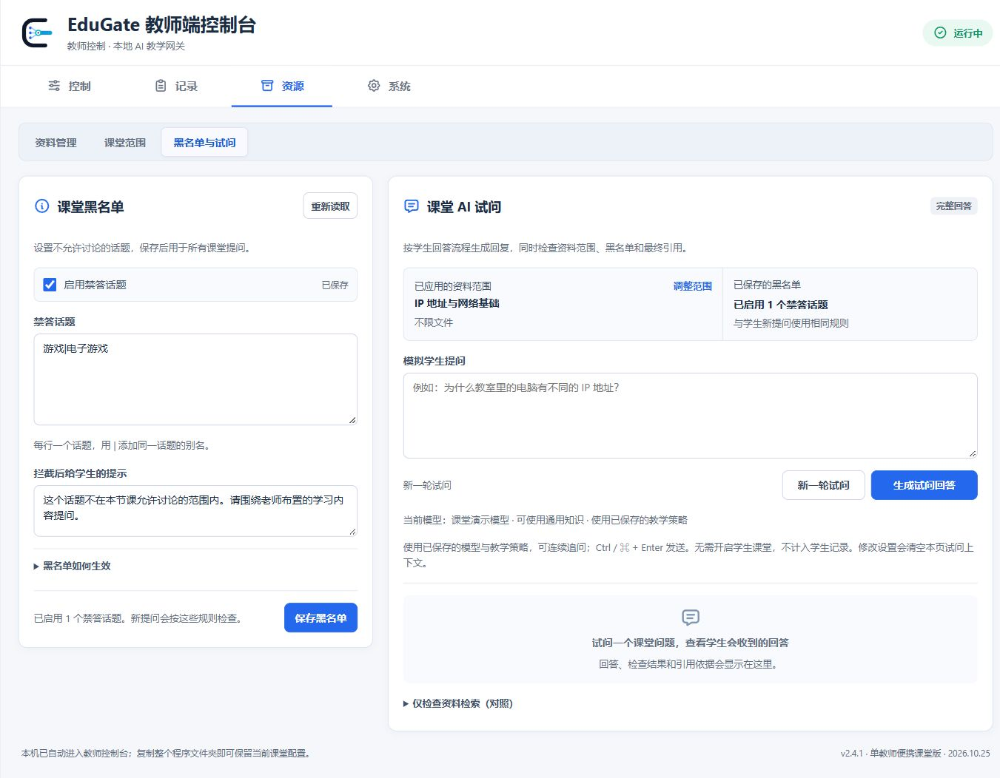
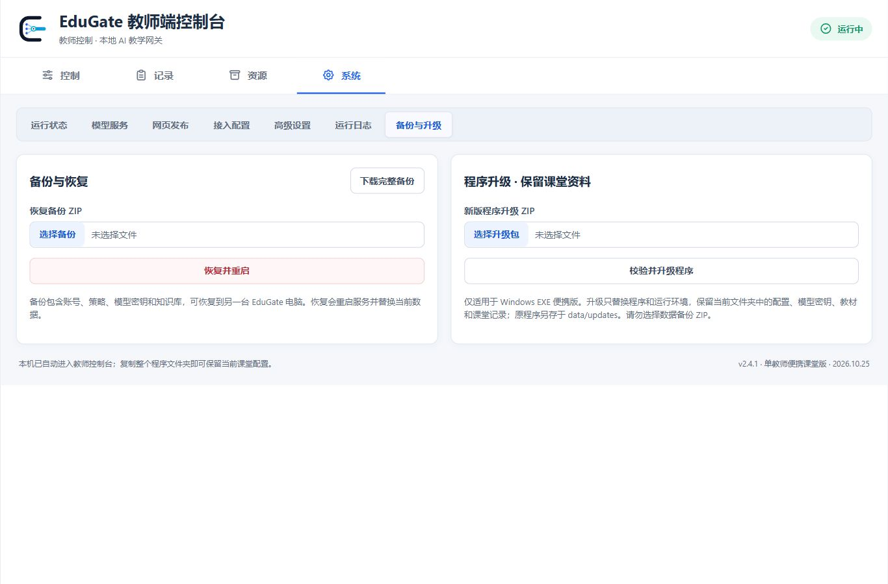

# 2.4.1 视觉对齐与交互检查

检查于 2026-10-25 至 26 日进行，沿用 EduGate 已有蓝白界面、字体和组件规范。先采集 2.4.0 页面，再在相同 1366×900 视口逐页比较修改结果；另检查实际 2.4.1 EXE 页面。

## 页面检查

| 步骤 | 页面 | 检查结果 |
| --- | --- | --- |
| 1 | 控制 | 模型与知识库选择框等宽，刷新按钮和选择框中心对齐；修复窄窗口下知识库图标单独换行，保留原双栏布局。 |
| 2 | 记录 | 刷新按钮恢复 40px 高度并居中；统计、筛选和详情区保持清晰。 |
| 3 | 资源 / 资料管理 | 标题行同高，文件选择框、知识库下拉框与上传按钮对齐。 |
| 4 | 资源 / 课堂范围 | 标题、说明和表单起点与资料管理页一致，双栏间距统一。 |
| 5 | 资源 / 黑名单与试问 | 左右标题与说明对齐；操作按钮宽度稳定，模型显示名称可读，长问题支持折叠。 |
| 6 | 系统 / 运行状态 | 标题与操作行居中，统计卡片间距一致。 |
| 7 | 系统 / 模型服务 | 标题行与其他系统页对齐，供应商和模型编辑布局保持可用。 |
| 8 | 系统 / 网页发布 | 文件框与名称输入框及上传按钮同高。 |
| 9 | 系统 / 接入配置 | 两张卡片的标题与表单起点一致，调用示例保持折叠。 |
| 10 | 系统 / 高级设置 | 复选框与同行输入框垂直中心一致，数据库参数显示中文名称。 |
| 11 | 系统 / 运行日志 | 标题、记录和日志区的边距与同级页面一致。 |
| 12 | 系统 / 备份与升级 | 下载移到标题区，两栏的选择框、执行按钮和说明逐行对齐。 |

## 修改前后

资料管理：原上传卡片标题偏高，文件选择框也略高于相邻控件；修改后标题行与控件边缘一致。

黑名单与试问：统一两栏标题和说明起点，试问显示模型名称，固定按钮宽度。

备份与升级：原先左栏先执行后选文件，导致双栏错位；改为两栏均先选文件、再执行，下载仍保持独立入口。

## 实测证据

- 主输入控件 40px；文件选择框由约 41.6px 修正为 40px，记录刷新按钮由约 53.6px 修正为 40px。
- 模型与知识库选择框右边缘相同，各自刷新按钮与选择框中心 Y 坐标一致。
- 最终窄窗口复查发现知识库图标单独换行，已统一两组选项的换行行为；480、768、1024、1366px 再测图标中心与控件中心一致，且两组标签左边缘相同。
- 备份恢复与升级的文件框和执行按钮分别处于相同 Y 坐标。
- 滚动后主导航底部与二级导航顶部均为约 56.8px；点击主选项卡返回页面顶部。
- 试问初始状态与完成状态的主按钮宽度均为 144px；本轮没有单独采集慢请求中的按钮状态。
- 293 字符长提问折叠后为一行，键盘 Enter 展开后可读完整文本。
- 控制、记录、资料管理、黑名单与试问、备份与升级在 1024、768、480px 宽度均无页面横向溢出。
- 实际 EXE 提供的 HTML、CSS 与 JavaScript 与源码字节一致；浏览器完整试问显示回答与检查阶段，控制台无错误。

## 范围和限制

公开截图只使用隔离演示数据。真实模型、配置、密钥、课堂记录和本机备份保留在本机，没有随文档发布。其余页面截图及尺寸测量保存在本地 `artifacts/visual-alignment-20261025/`。

本轮确认视觉对齐、主要导航、完整试问及相关折叠交互；截图和局部键盘检查不等于完整无障碍合规测试。没有重新宣称真实 U 盘、第二台物理电脑、网页大包上传或 Windows 原生退出通知的视觉端到端验证。
